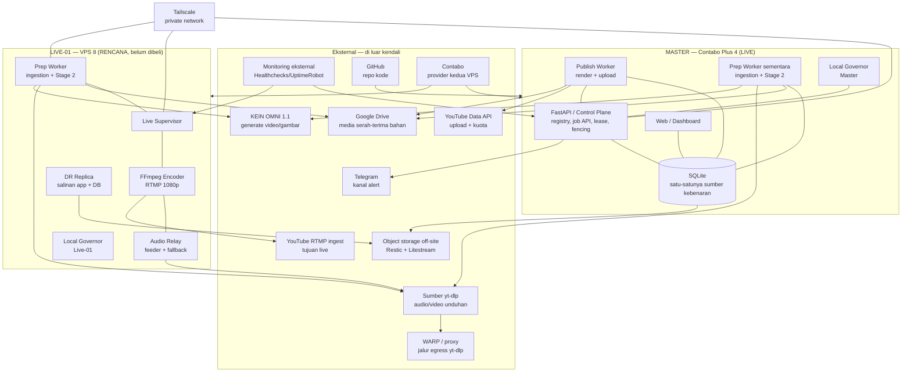

# GRAF DEPENDENSI — MASJAVAS TUBE OS V2

**Status:** DOKUMEN RENCANA (Workstream H). Graf ini memetakan komponen
MASJAVAS TUBE OS pada arsitektur target V2 (Master + Live-01) beserta
dependensi eksternalnya, dan apa yang terjadi bila tiap dependensi mati.
Komponen yang BELUM ADA (VPS 8, backup off-site, monitoring eksternal)
ditandai — jangan baca graf ini sebagai keadaan kini.
**Sumber utama:** `MASTER_ARCHITECTURE_MASJAVAS_TUBE_OS_V2.md` §5
(High-Level Architecture), §19 (Failure Scenarios), §20 (CAP),
§4 (Capacity), §14 (Backup); `PLAN_PENAMBAHAN_VPS8_2026-11-22.md` §4–§5;
`ENGINEERING_READINESS_DASHBOARD.md`; `v2-001/` (KEIN), `v2-002/`,
`v2-003/`.
**Terakhir diperbarui:** 22 Nov 2026.

**Label bukti:** `[VERIFIED FACT]` / `[DOCUMENTED FACT NOT YET REVALIDATED]` /
`[ASSUMPTION]` / `[PROPOSAL]` / `[OPEN QUESTION]` /
`[OWNER DECISION REQUIRED]`.

---

## 1. Diagram

Catatan diagram: panah `-->` = "memakai / mengirim ke"; garis `---` =
"terhubung / berada di". Worker LoopGen Opsi 3 (agent Muse AI di VM
terpisah) tidak digambar sebagai node sendiri — mereka memakai API
yang sama dengan worker lain (klaim/generate/submit via API Master)
dan mengisi bahan lewat Drive; lihat §3 baris "Worker LoopGen Opsi 3".

## 2. Inventaris komponen

| Komponen | Host / lokasi | Peran | Status |
|---|---|---|---|
| FastAPI / Control Plane | Master | Registry, job API, scheduler/dispatcher, lease + fencing, deployment compatibility, dashboard operasional | `[VERIFIED FACT — berjalan kini]` |
| SQLite | Master (`/opt/masjavas-os/data/masjavas_tube.sqlite`, 118 MB) | Satu-satunya sumber kebenaran job ownership | `[VERIFIED FACT]` |
| Publish Worker | Master | Render + upload YouTube | `[VERIFIED FACT — berjalan kini]` |
| Prep Worker (sementara) | Master | Ingestion + LoopGen Stage 2 (sementara; pindah ke VPS 8 di Fase 1) | `[VERIFIED FACT — berjalan kini]` |
| Web / Dashboard | Master | Dashboard + API operator | `[VERIFIED FACT — berjalan kini]` |
| Local Governor (Master) | Master | Guard loop V2 + admission legacy (split — lihat runbook §3) | `[VERIFIED FACT — V2-003]` |
| Live Supervisor + Encoder + Relay | Master kini; Live-01 target | FFmpeg RTMP 1080p, relay audio HLS, watchdog feeder | `[VERIFIED FACT — berjalan kini di Master]` |
| Live-01 (VPS 8) | Rencana Contabo Core VPS 8 | Live + prep worker + DR replica | `[PROPOSAL — belum dibeli]` |
| Tailscale | Tailnet (Master 100.65.206.22) | Private network antar-box; satu-satunya jalur SSH | `[VERIFIED FACT]` |
| Google Drive | Eksternal | Media serah-terima bahan (folder 01–04 per channel); sync kuota P2 belum terpecahkan | `[VERIFIED FACT]` |
| YouTube Data API | Eksternal | Upload (kuota 10.000 unit/hari/project; 1 video = 1.650 unit) | `[VERIFIED FACT]` |
| YouTube RTMP ingest | Eksternal | Tujuan stream live | `[VERIFIED FACT]` |
| KEIN OMNI 1.1 | Eksternal (`beliapi.com` / `kein.my.id` — satu akun) | Generate video/gambar LoopGen Tahap 1/2 | `[VERIFIED FACT — plan berakhir 23 Nov 2026; status live unknown (R15)]` |
| Worker LoopGen Opsi 3 | VM agent terpisah (Satu Digital dkk.) | Klaim/generate/submit bahan via API | `[VERIFIED FACT]` |
| yt-dlp + WARP/proxy | Master (prep) | Unduh audio/video; bot-check D1 belum selesai (residential 407) | `[VERIFIED FACT]` |
| Monitoring eksternal + Telegram | Eksternal (rencana) | Healthchecks/UptimeRobot + alert Telegram | `[PROPOSAL — Track P8.1; notifier Telegram sudah ada di kode]` |
| Object storage off-site | Eksternal (rencana) | Restic + Litestream | `[PROPOSAL — provider belum dipilih, V2-009]` |
| GitHub | Eksternal | Repo kode privat (`masjavas7/MASJAVASTUBE-OS`); repo plan (`masjavas7/MASJAVAS-PLAN-OS-NEW`) | `[VERIFIED FACT]` |
| Contabo | Provider | Kedua VPS (Master kini; VPS 8 rencana) | `[VERIFIED FACT — Master; VPS 8 rencana]` |

## 3. Tabel dependensi — apa yang mati bila dependensi mati

| # | Konsumen → Dependensi | Bila dependensi mati | Blast radius | Mitigasi / track |
|---|---|---|---|---|
| D1 | Semua → **Master down** | Klaim + assignment baru berhenti. Live yang SUDAH berjalan tetap jalan (tidak butuh Master untuk mempertahankan encoder lokal). Worker tidak mengambil job baru; job belum selesai menunggu rekonsiliasi. | Publish + prep berhenti; live bertahan | V2.0 §19–§20 (CAP: consistency ownership kuat, availability lokal untuk live). DR replica VPS 8 (rencana). |
| D2 | Semua → **SQLite lock / corrupt** | Claim/status terlambat (lock 31×/24 jam baseline). Corrupt → recovery gagal total. | Seluruh operasi Master | Retry transaksi pendek, optimasi writer; integrity check + restore drill (V2.0 §19). PostgreSQL HANYA bila trigger §9.4 terbukti. |
| D3 | Live-01 → **Tailscale down** | Control plane tidak dapat menghubungi worker. Live berjalan; assignment baru ditahan; alarm heartbeat >90 dtk (Plan §8). | Kendali jarak jauh hilang; live bertahan | Live lokal otonom; penugasan baru tertunda sampai pulih (V2.0 §19). |
| D4 | Live → **Live-01 down** | Live shard terputus. | Semua stream di shard itu | Alarm eksternal; recovery manual/box cadangan sesuai kapasitas (V2.0 §19). Master menampung darurat ±20 stream (Plan §8). |
| D5 | Publish → **YouTube Data API / kuota** | `quotaExceeded` → API call gagal. | Upload berhenti sampai reset | Pause + tunggu reset; JANGAN auto-retry (doktrin kuota). Vault 5 channel/maks. |
| D6 | Live → **YouTube RTMP ingest** | Encoder gagal menulis trailer / muxing timeout (tanda kematian #14: `Connection timed out`). | Stream putus; supervisor reconnect | Supervisor recovery + R6 telemetry; watchdog relay (R3b). |
| D7 | Prep/Publish → **Google Drive** | Bahan tidak bisa diunduh/diupload; sync kuota P2 (mekanisme BELUM DIKETAHUI — 6 teori tereliminasi). | Ingestion + publish bahan berhenti | Drive = satu-satunya media serah-terima (V2.0 §5) — tidak ada jalur bahan alternatif. P2 diagnostik saja. |
| D8 | LoopGen → **KEIN** | Tahap 1/2 (API-bound) berhenti. Plan berakhir 23 Nov 2026; status live UNKNOWN (R15, diterima owner). | Generate video/gambar baru berhenti; Stage 2 kehabisan bahan baru | Fallback TIDAK diputuskan (D1 ditutup atas asumsi "KEIN aman"). Opsi 3 (agent) independen dari KEIN untuk video. |
| D9 | Ingestion → **yt-dlp + proxy (D1)** | Unduhan audio gagal (bot-check; residential 407; hanya WARP datacenter hidup). | Audio channel baru berhenti (NO 171/172: 0/30) | D1 ditunda user — jangan tanya ulang. Pool derivation memitigasi, bukan memperbaiki. |
| D10 | Semua → **Disk penuh** | Job dan encoder berisiko gagal. | Semua workload di box itu | Admission stop, quota per workload, janitor quarantine (V2.0 §19, §10.5). |
| D11 | Live → **TX saturasi** | Live buffering. | Kualitas live turun | Stop prep upload, network shaping, admission TX (V2.0 §19, §10.6). |
| D12 | Worker → **Worker crash** | Job tertinggal. | Job itu saja | Lease expiry + requeue (V2.0 §19, §8.3). |
| D13 | Semua → **Backup corrupt / hilang** | Recovery gagal. | Pemulihan bencana gagal | Integrity check + restore drill bulanan (V2.0 §19). Backup independen di luar kedua VPS. |
| D14 | Semua → **Contabo (provider/akun)** | Kedua VPS dapat ikut hilang (satu provider, satu akun). | SELURUH sistem + DR replica VPS 8 | Backup independen off-site (bukan di Contabo) — satu-satunya mitigasi; provider belum dipilih (V2-009). |
| D15 | Operasi → **GitHub down** | Deploy kode baru tertunda; repo plan tidak dapat diakses. | Deployment, bukan operasi berjalan | Operasi berjalan tidak bergantung pada GitHub (kode sudah di VPS). |
| D16 | Prep → **Worker LoopGen Opsi 3** | Bahan baru (gambar/video AI) berhenti; klaim kedaluwarsa otomatis (image 2 jam, video 6 jam) dan kembali ke pool. | Throughput bahan turun; pekerjaan tidak hilang | Klaim lease + takeover klaim basi (aturan teamwork). |

## 4. Single points of failure (SPOF)

| SPOF | Keterangan | Rencana mitigasi |
|---|---|---|
| Master (satu box) | Satu control plane + satu SQLite. Down = tidak ada klaim/assignment baru. | DR replica VPS 8 (rencana, Plan §6 langkah 1.4); live bertahan lokal (V2.0 §20). HA Master penuh TIDAK direncanakan di V2 (di luar scope). |
| SQLite (satu file) | Satu-satunya sumber kebenaran; corrupt = recovery dari backup. | Backup konsisten + drill (rencana backup); Litestream opsional. |
| Google Drive (satu media serah-terima) | Tidak ada jalur bahan alternatif antar-box selain Drive/API (V2.0 §5). | Tidak ada mitigasi dalam V2 — P2 harus dipecahkan (diagnostik berjalan). |
| YouTube Data API (kuota per project) | Kuota adalah batas keras harian. | Doktrin 1 post/hari + 5/vault; ekspansi vault (target ~140 untuk 696 channel). |
| KEIN (satu akun, satu provider) | Satu-satunya generator Tahap 1/2 (selain Opsi 3 agent). | Fallback tidak diputuskan (D1 ditutup). Risiko diterima owner (R1/R15). |
| Contabo (satu provider + satu akun) | Kedua VPS di provider yang sama. | Backup off-site independen (D14). |
| Tailscale (satu tailnet) | Satu-satunya jalur SSH + API antar-box. Perilaku tailnet bila control plane Tailscale down BELUM DIVERIFIKASI untuk setup ini. | `[OPEN QUESTION — verifikasi perilaku offline tailnet]` |

## 5. Prinsip propagasi (V2.0 §20 — CAP)

- Consistency ownership yang kuat di Master; availability lokal untuk
  live yang sudah berjalan.
- Saat Master tidak tersedia: live aktif tetap berjalan; worker tidak
  menerima job baru; worker TIDAK BOLEH membuat ownership baru secara
  lokal; job yang belum selesai menunggu rekonsiliasi; setelah koneksi
  pulih, Master memeriksa lease, fencing, dan job events.
- Prioritasnya: mencegah dua worker mengerjakan side effect yang sama
  — BUKAN mempertahankan seluruh operasi distributed saat control
  plane terputus.

## 6. Pertanyaan terbuka

1. Perilaku tailnet bila control plane Tailscale tidak tersedia —
   `[OPEN QUESTION — §4]`.
2. Provider object storage off-site (mitigasi D14) —
   `[OWNER DECISION REQUIRED — V2-009]`.
3. Jalur bahan alternatif bila Drive down berkepanjangan — tidak ada
   dalam V2; apakah perlu dirancang —
   `[OPEN QUESTION]`.
4. Failover live manual vs otomatis (D4 dalam tabel §3) —
   `[OWNER DECISION REQUIRED — Plan §10 #4]`.
5. Apakah monitoring eksternal juga memantau VPS 8 setelah dibeli
   (ya — P8.1 mencakup keduanya) dan siapa yang menerima alert
   bila owner tidak merespons — `[OPEN QUESTION]`.
